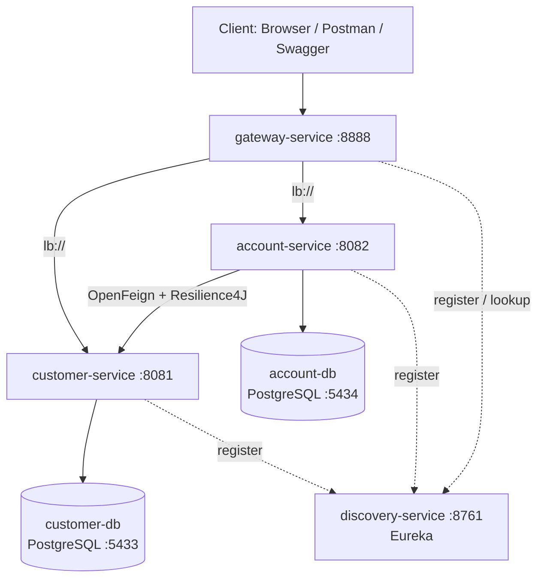

# Distributed Banking System — Spring Cloud & Spring AI

A microservices banking application built step by step, following Prof. Mohamed YOUSSFI's course series, with **PostgreSQL in Docker** instead of H2.

## Architecture



## Services

| Service | Port | Role |
|---|---|---|
| `discovery-service` | 8761 | Eureka service registry |
| `gateway-service` | 8888 | Single entry point, routes requests to services |
| `customer-service` | 8081 | Customers (Spring Data REST) |
| `account-service` | 8082 | Bank accounts, enriched with customer data via OpenFeign |
| `customer-db` | 5433 | PostgreSQL for customer-service |
| `account-db` | 5434 | PostgreSQL for account-service |

## Tech stack

| Area | Technology |
|---|---|
| Language | Java 21 |
| Framework | Spring Boot 4.1.1, Spring Cloud 2025.1.3 |
| Persistence | Spring Data JPA, Spring Data REST, PostgreSQL 18 |
| Communication | OpenFeign, Spring Cloud LoadBalancer |
| Resilience | Resilience4J (circuit breaker) |
| Discovery / Routing | Eureka, Spring Cloud Gateway (WebFlux) |
| Docs / Tests | springdoc OpenAPI (Swagger UI), Postman |
| Infrastructure | Docker Compose |
| Test data | Datafaker |

## Getting started

### Prerequisites

- JDK 21
- Docker and Docker Compose
- IntelliJ IDEA (or any IDE) — Maven wrapper included in each module

### 1. Environment variables

```bash
cp .env.example .env
```

Edit `.env` and set real passwords. `.env` is ignored by Git.

### 2. Start the databases

```bash
docker compose up -d
docker compose ps
```

Wait until both containers are `healthy`.

### 3. Start the services (in this order)

1. `discovery-service`
2. `customer-service`
3. `account-service`
4. `gateway-service`

### 4. Check

| URL | Expected |
|---|---|
| http://localhost:8761 | Eureka dashboard with 3 registered services |
| http://localhost:8888/customers | Customers through the gateway |
| http://localhost:8888/accounts | Accounts with their customer |
| http://localhost:8888/customer-service/customers | Same, using the service name |
| http://localhost:8081/swagger-ui.html | Customer API documentation |
| http://localhost:8082/swagger-ui.html | Account API documentation |

A Postman collection is available in [`postman/`](postman/ebank.postman_collection.json).

## Project parts

| # | Branch | Content | Doc |
|---|---|---|---|
| 1 | `feature/core-services` | Customer & Account services, OpenFeign, Resilience4J, Eureka, Gateway, Swagger, Postman | [docs/01-core-services.md](docs/01-core-services.md) |
| 2 | `feature/ai-agent` | Spring AI agent, MCP | _coming next_ |

## Commit convention

[Conventional Commits](https://www.conventionalcommits.org): `type(scope): summary`, with a body explaining what and why.

Types used: `feat`, `fix`, `refactor`, `chore`, `build`, `docs`.

## Author

**Yousef ELHAID** — Software Engineering student (GLSID), ENSET Mohammedia
