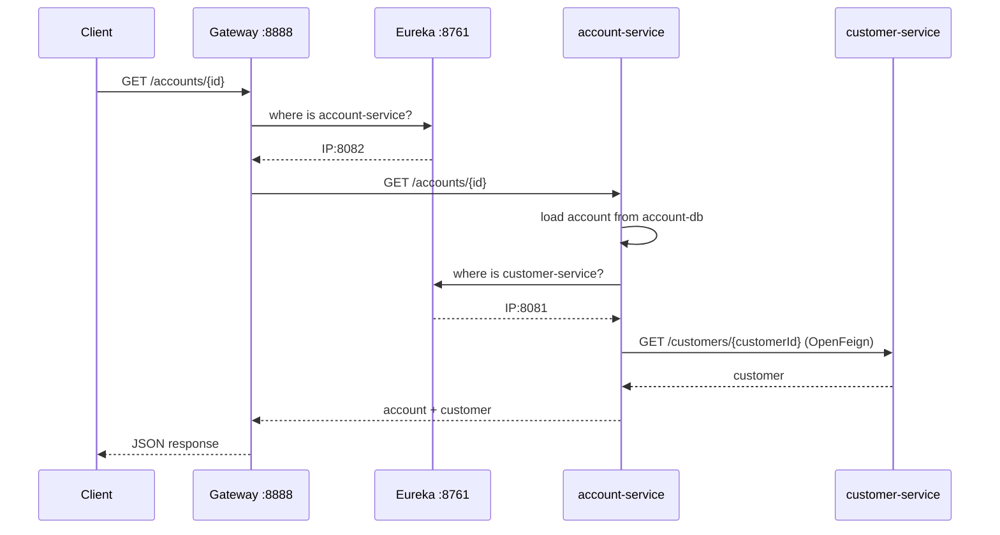
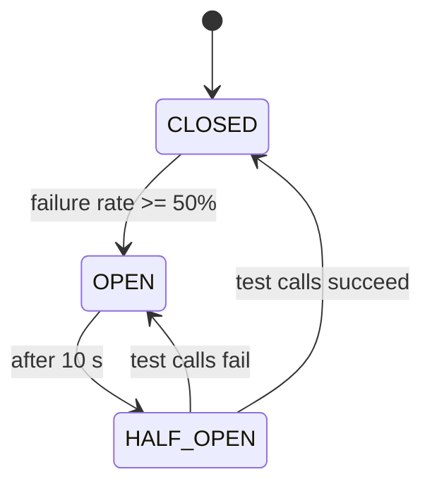

# Part 1 — Core Services

**Branch:** `feature/core-services`

Builds the microservices foundation: two business services with their own databases, service-to-service communication, fault tolerance, service discovery and an API gateway.

## What was built

| Step | Result |
|---|---|
| 1 | PostgreSQL databases in Docker Compose, configured from `.env` |
| 2 | `customer-service`: `Customer` entity, Spring Data REST repository, Datafaker seed |
| 3 | `account-service`: `BankAccount` entity, `AccountType` enum, REST repository |
| 4 | OpenFeign client from account-service to customer-service |
| 5 | Service layer in account-service (`AccountService` / `AccountServiceImpl`) |
| 6 | Resilience4J circuit breaker with a Feign fallback |
| 7 | `discovery-service` (Eureka) and service registration |
| 8 | `gateway-service` with static routes and dynamic routes from Eureka |
| 9 | Swagger UI and a Postman collection |

## Request flow



## customer-service

| Item | Detail |
|---|---|
| Entity | `Customer`: `id`, `firstName`, `lastName`, `email` (unique) |
| API | Generated by Spring Data REST on `/customers` (GET, POST, PUT, PATCH, DELETE) |
| Seed | 10 fake customers with Datafaker, only when the table is empty |
| Note | `exposeIdsFor(Customer.class)` so the `id` appears in JSON |

## account-service

| Item | Detail |
|---|---|
| Entity | `BankAccount`: `accountId` (UUID), `balance`, `createdAt`, `currency`, `type`, `customerId`, transient `customer` |
| Enum | `AccountType`: `CURRENT_ACCOUNT`, `SAVING_ACCOUNT`, stored as text |
| Layers | `web` → `service` → `repository` + `client` |
| API | `/accounts`, `/accounts/{id}` (controller, with customer), `/bankAccounts` (Spring Data REST) |
| Errors | `AccountNotFoundException` → HTTP 404 |
| Seed | One current and one saving account per customer, fetched through OpenFeign |

### Package structure

```
ma.enset.accountservice
├── client       CustomerRestClient, CustomerRestClientFallback
├── entity       BankAccount
├── enums        AccountType
├── exception    AccountNotFoundException
├── model        Customer (record, not persisted)
├── repository   BankAccountRepository
├── service      AccountService, AccountServiceImpl
└── web          AccountRestController
```

## OpenFeign

```java
@FeignClient(name = "customer-service", fallback = CustomerRestClientFallback.class)
public interface CustomerRestClient {
    @GetMapping("/customers/{id}")
    Customer findCustomerById(@PathVariable("id") Long id);

    @GetMapping("/customers")
    PagedModel<Customer> allCustomers();
}
```

- Enabled with `@EnableFeignClients` on the main class.
- `PagedModel` reads the HAL format returned by Spring Data REST.
- The service is resolved **by name** through Eureka; no hard-coded URL.

## Resilience4J circuit breaker



| Setting | Value |
|---|---|
| Activation | `spring.cloud.openfeign.circuitbreaker.enabled: true` |
| Sliding window | 10 calls |
| Failure threshold | 50% |
| Wait in open state | 10 s |
| Calls in half-open | 3 |
| Call timeout | 3 s |
| Fallback | Customer with `"Not available"` fields; empty page for the list |

## Discovery service (Eureka)

```yaml
server:
  port: 8761
eureka:
  client:
    register-with-eureka: false
    fetch-registry: false
```

Clients register with `eureka.instance.prefer-ip-address: true` and use the default URL `http://localhost:8761/eureka`.

## Gateway

Static routes:

| Path | Target |
|---|---|
| `/customers/**` | `lb://customer-service` |
| `/accounts/**`, `/bankAccounts/**` | `lb://account-service` |

Dynamic routes (discovery locator): any registered service is reachable as `/<service-name>/**`, for example `/customer-service/customers`.

> Property prefix for recent Spring Cloud versions: `spring.cloud.gateway.server.webflux.*`.

## Configuration pattern

All services read the root `.env` through:

```yaml
spring:
  config:
    import:
      - "optional:file:.env[.properties]"
      - "optional:file:../.env[.properties]"
      - "optional:configserver:"
```

Values in quotes: a YAML value ending with `:` must be quoted.

## Lessons learned

| Issue | Fix |
|---|---|
| IntelliJ shows `lombok` / `jakarta` in red after generating a module | Pin the Maven wrapper to 3.9.11 in `.mvn/wrapper/maven-wrapper.properties` |
| `optional:configserver:` crashes the app | Quote it in YAML |
| Second start fails on duplicate email | Seed only when `count() == 0` (PostgreSQL keeps data, unlike H2) |
| Postgres 18 container won't start | Mount the volume on `/var/lib/postgresql`, not `/var/lib/postgresql/data` |
| Reactive gateway fails at startup | Do not add Spring Web (MVC) to the gateway |

## Checklist for a new service

1. Generate the module (Maven, Java 21, Spring Boot 4.1.1).
2. Delete the module `.gitignore` and `HELP.md`.
3. Pin the Maven wrapper to 3.9.11, then reload Maven.
4. Add a database container in `docker-compose.yml` and variables in `.env.example`.
5. Configure `application.yaml` with the `.env` import and a unique port.
6. Register in Eureka (`prefer-ip-address: true`).
7. Add a gateway route if needed.
