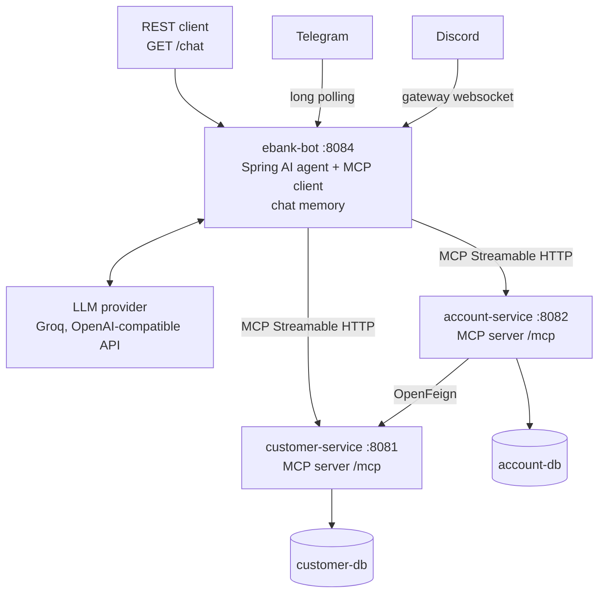
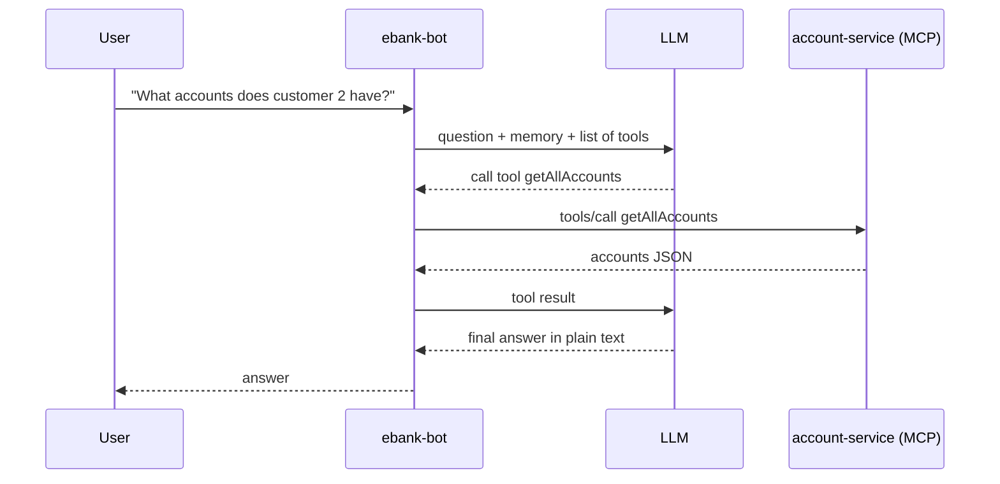

# Part 2 — AI Agent & MCP

**Branch:** `feature/ai-agent`

Adds an AI assistant that answers questions about customers and bank accounts. The business services expose their features as **MCP tools**, and a separate **ebank-bot** service uses an LLM to call those tools. The bot is reachable over REST, Telegram and Discord.

## What was built

| Step | Result |
|---|---|
| 2.1 | `customer-service`: service layer + MCP server with 3 tools |
| 2.2 | `account-service`: MCP server with 2 tools |
| 2.3 | Tools tested by hand with MCP Inspector |
| 2.4 | `ebank-bot`: Spring AI agent with per-conversation memory, REST `/chat` |
| 2.5 | `ebank-bot` connected to both MCP servers |
| 2.6 | Telegram bot (TelegramBots 10, long polling) |
| 2.7 | Discord bot (JDA 6) |

## Architecture

## How a question is answered

The LLM never accesses a database. It only asks the bot to call a tool; the bot calls the MCP server and sends the result back.

## MCP servers

Both business services use the same setup.

| Item | Detail |
|---|---|
| Dependency | `spring-ai-starter-mcp-server-webmvc`, with the Spring AI 2.0 BOM imported |
| Server type | `SYNC` |
| Protocol | `STREAMABLE` — exposes `POST /mcp` automatically |
| Where the tools live | A dedicated `mcp` package (`CustomerMcpTools`, `AccountMcpTools`) |
| How tools are declared | `@McpTool` on each method (name + description), `@McpToolParam` on each parameter |
| Design | Tool classes only delegate to the service layer, like a controller does for HTTP |

| Service | Tool | Description |
|---|---|---|
| customer-service | `getAllCustomers` | All customers |
| customer-service | `getCustomerById` | One customer by id |
| customer-service | `saveCustomer` | Create a customer (first name, last name, email) |
| account-service | `getAllAccounts` | All accounts with their owner customer |
| account-service | `getAccountById` | One account by id, with its owner customer |

> The tool **description** is what the LLM reads to decide which tool to call. Clear, specific descriptions give better answers.

## ebank-bot

### Packages

| Package | Class | Role |
|---|---|---|
| `agent` | `EbankAIAgent` | Builds the chat client and answers questions |
| `web` | `ChatController` | REST endpoint |
| `telegram` | `TelegramBot` | Telegram adapter |
| `discord` | `DiscordBot` | Discord adapter |

### Dependencies

| Dependency | Role |
|---|---|
| Spring AI OpenAI starter | Chat model — works with any OpenAI-compatible provider |
| Spring AI MCP client starter | Connects to the MCP servers and loads their tools |
| TelegramBots 10.3.0 (Spring Boot long polling starter + client) | Telegram bot |
| JDA 6.3.1, without the `opus-java` voice module | Discord bot |
| Spring Web, Eureka client, Actuator, Lombok | Usual service setup |

### Configuration

| Property | Value | Why |
|---|---|---|
| `spring.ai.openai.api-key` | from `GROQ_API_KEY` in `.env` | Secret, never committed |
| `spring.ai.openai.base-url` | Groq's OpenAI-compatible endpoint (`/openai/v1`) | The OpenAI starter works unchanged |
| `spring.ai.openai.chat.model` | `qwen/qwen3.8-27b` | In Spring AI 2.0 the model is directly under `chat` |
| `spring.ai.openai.chat.extra-body.reasoning_effort` | `none` | `qwen3` is a reasoning model; this makes it answer directly |
| `spring.ai.mcp.client.streamable-http.connections.customer.url` | `http://localhost:8081/mcp` | customer-service tools |
| `spring.ai.mcp.client.streamable-http.connections.account.url` | `http://localhost:8082/mcp` | account-service tools |
| `server.port` | `8084` | |
| `telegram.token` | from `TELEGRAM_BOT_TOKEN` | Secret |
| `discord.token` | from `DISCORD_BOT_TOKEN` | Secret |

### The agent

| Part | Role |
|---|---|
| System prompt | Banking assistant; must use the tools; says "I don't know" when the tools don't give the answer; replies in the user's language |
| Chat memory advisor | Adds the previous messages of the same conversation to each call |
| Tool callbacks | All tools found by the MCP client, sent to the LLM with every question |
| Conversation id | One memory per conversation — required on every call in Spring AI 2.0 |

### Channels

| Channel | Entry point | Conversation id | Message limit |
|---|---|---|---|
| REST | `GET /chat?query=...&conversationId=...` | request param, default `web` | — |
| Telegram | long polling bot created with @BotFather | `telegram-<chatId>` | 4096 chars |
| Discord | JDA listener on every visible message | `discord-<channelId>` | 2000 chars |

All three channels call the **same** agent. Adding a new channel only means adding a new adapter class (Adapter pattern).

**Discord setup:** enable **MESSAGE CONTENT INTENT** in the Developer Portal, and invite the bot with the `bot` scope and *View Channels*, *Send Messages*, *Read Message History* permissions. There are no commands: the bot answers every message it can see, and ignores messages from bots.

## Startup order

1. Databases (Docker Compose)
2. `discovery-service`
3. `customer-service`, `account-service`
4. `gateway-service`
5. `ebank-bot` — **last**: its MCP client connects to both MCP servers at startup, and the app fails if one is down.

To check that an MCP server is up, send an empty POST to `/mcp`: a **400** answer means it is running (the request is just incomplete); *connection refused* means it is not.

## Testing

| Tool | How |
|---|---|
| MCP Inspector | Run it with `npx`, choose *Streamable HTTP*, enter the service's `/mcp` URL, then *List Tools* / *Run Tool* |
| REST | Open `http://localhost:8084/chat?query=...` in the browser |
| Telegram | Message the bot |
| Discord | Post in a channel the bot can see |

| Question | Tools used |
|---|---|
| `List the customers` | `getAllCustomers` |
| `Who is customer 3?` | `getCustomerById` |
| `What accounts does customer 2 have and what is the total balance?` | `getAllAccounts` |
| `Create a customer: Sara Benali, sara@mail.ma` | `saveCustomer` |
| `My name is Yousef` → `What is my name?` | none (memory) |

## Screenshots

### MCP Inspector

### REST chat

### Telegram

### Discord

## Lessons learned

| Issue | Fix |
|---|---|
| `conversationId cannot be null` | Spring AI 2.0 requires a conversation id on each call |
| `401 Incorrect API key` with a `gsk_` key | That's a Groq key: point `base-url` to Groq's OpenAI-compatible endpoint |
| Model setting ignored | Spring AI 2.0 uses `chat.model`, not `chat.options.model` |
| ebank-bot fails with `ConnectException` / `Client failed to initialize` | Start the MCP servers before ebank-bot |
| `@McpTool` import not found | In Spring AI 2.0 the annotations moved under `org.springframework.ai`; 1.x used `org.springaicommunity` |
| Old Telegram starter (6.x) incompatible with Spring Boot 4 | Use TelegramBots 10 and its Spring Boot long polling starter |
| Telegram `409 Conflict` | Two bot instances polling with the same token — stop one |
| Discord bot receives empty text | Enable MESSAGE CONTENT INTENT in the Developer Portal |

## Checklist: expose a new service to the AI agent

1. Import the Spring AI BOM and add the WebMVC MCP server starter.
2. Configure the MCP server with the `STREAMABLE` protocol.
3. Make sure the logic is in a service layer.
4. Add an `mcp` tools class whose `@McpTool` methods call the service, with clear descriptions.
5. Test the tools with MCP Inspector.
6. Add a connection for the new service in ebank-bot's MCP client configuration.
7. Restart the service, then ebank-bot.
